# SysAgent 管家功能与使用指南

**适用范围：SysAgent 0.2.17 当前源码 · 独立 AgentSight 0.16.0 · 整理日期：2026-11-13**

面向第一次使用管家的用户，以及希望让脚本、其他应用查询管家数据的开发者。[打开浏览器阅读版](./FUNCTION-USER-GUIDE.html)；复制文档时请同时保留 `assets/user-guide/` 配图目录。

> **先分清三件事：** 有页面，不等于已有真实后端；请求成功，不等于设备或业务正常；源码已实现，不等于正在运行的旧安装包已更新。
>
> 本文配图来自改名前 0.2.15 React 界面的隔离浏览器运行，不是设计稿；保留原始说明性截图，画面中的 SysOM 名称与旧时间格式不代表 0.2.17 的显示。资源、GPU、Agent 报告使用人工构造的说明性证据；设备、日志、部署和 GPU 事件页面含内置 Demo。截图下方均有标注，不代表这台机器的实测结果，也没有执行真实采集、结束进程、安装或模型调用。桌面浮窗与 IDE 外壳按当前实现说明；配图不替代本批次独立的原生验收，具体范围见“验证范围说明”。

## 阅读路线

- **普通用户：** 先读第 1–3 节，再按需要查看资源、GPU 或 Agent 用法。
- **判断哪些能用：** 看第 9 节完成状态表；不要仅凭按钮判断。
- **第三方开发者：** 看第 10–11 节，完整参数和安全约束见[本机 HTTP API 文档](./LOCAL-HTTP-API.md)。
- **安装与升级：** 以[项目 README](../README.md)中的当前发布批次说明为准，本文不替代安装说明。

---

## 1. 它是什么，能帮你做什么

SysAgent 管家是一套本机运维与诊断界面：先把设备资源、进程和 Agent 运行证据收集起来，再说明哪些有问题、哪些没有足够证据，最后提供详情与报告。

| 模块 | 主要回答的问题 | 当前能力概况 |
| --- | --- | --- |
| 体检首页 | 本机资源是否紧张？哪些检查需要关注？ | 真实资源、部分体检、评分、报告与巡检配置 |
| 资源详情 | 谁占用 CPU、内存或产生磁盘 I/O？ | 已采集进程 Top10、Agent 筛选、受控进程结束 |
| 设备管理 | 能否查看和切换设备？ | 本机部分指标真实；远程设备与接入流程为演示 |
| GPU 诊断 | 卡上有什么指标？是否有异常证据？ | 本机逐卡资源、按需原生 AI 检查、部分作业证据；事件案例为演示 |
| Agent 管家 | Agent 进程、会话、Token、中断和延迟怎样？ | 独立 AgentSight → SysAgent 分析 → 本机只读报告 |
| 研发运维 | 部署流程如何组织？ | 确认后运行模拟流程，不部署真实应用 |
| 日志分析 | 如何筛选日志并查看分析进度？ | 内置日志与模拟任务，不是本机日志平台 |
| 本机查询接口 | 其他程序能读到哪些结果？ | 源码已实现只读 HTTP、15 个数据集及 OpenAPI 契约 |

### 两种使用入口

- **桌面版：** Electron 主窗口 + 浅蓝色悬浮小管家。
- **IDE 版：** VS Code 兼容扩展的 Webview 面板 + 状态栏，例如 VS Code、Qoder IDE。Qoder Desktop 独立应用和 JetBrains 不是这份 VSIX 的宿主。

两端复用主要页面与分析逻辑，但**每个宿主实例的资源缓存、设备标识、巡检设置和 HTTP 查询实例独立**。相同用户环境下可复用同一个 AgentSight 来源，不表示两端资源快照自动同步。IDE 查看的是本地扩展宿主所在机器，不是自动查看 SSH 远程工作区。

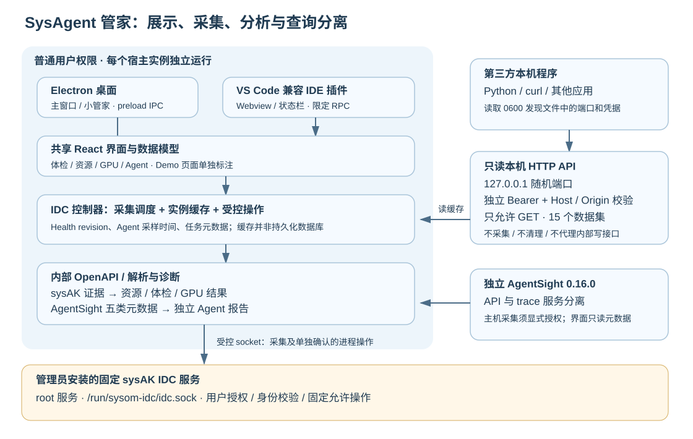

**图 1：结构图。** 外部程序只读管家缓存；内部分析接口、系统采集 socket 和公共查询 HTTP 是不同边界，不可混用凭据。

## 2. 首次打开：先确认服务，再看数据

### 2.1 安装前提

当前发布主要面向 Linux x86_64 图形桌面，README 要求 glibc 2.38+，并说明管理员安装、systemd、Python 与 IDE 版本条件。建议新用户按 README 的离线包安装入口操作，而不是从源码目录找脚本尝试。

- 日常启动桌面和 IDE 使用普通用户，**不要用 sudo 启动 GUI**。
- 系统资源需要安装且授权当前用户的 sysAK IDC 服务。只复制 AppImage／VSIX 不会自动安装它。
- Agent 诊断依赖独立 AgentSight 配套件或已经运行的明确配置服务；不是可选 Python FastAPI 骨架。
- 本文没有执行安装、修改服务、修改权限或升级软件。

### 2.2 桌面操作

1. 从应用菜单打开“SysAgent管家”，或按 README 的入口启动。
2. 主窗口显示体检首页；点击左侧导航切换模块。
3. 关闭或最小化主页会收起为悬浮小管家，不是彻底退出。
4. 单击小管家恢复主页；按住拖动调整位置。
5. 要彻底退出，右键小管家选择“退出”。退出宿主后，该实例的巡检和本机查询服务停止；独立授权的 AgentSight trace/API 服务不因此停止。

### 2.3 IDE 操作

1. 通过“从 VSIX 安装”安装当前插件，按提示重载 IDE。
2. 点击状态栏 SysAgent，或命令面板执行 **SysAgent管家: 打开体检主页**（`sysagent.openHome`）。
3. 命令 **SysAgent管家: 立即巡检本机**（`sysagent.inspect`）触发本机体检。
4. 关闭面板不等于扩展退出。状态栏告警可以打开相应健康详情；面板可再次打开。

### 2.4 数据拿不到时

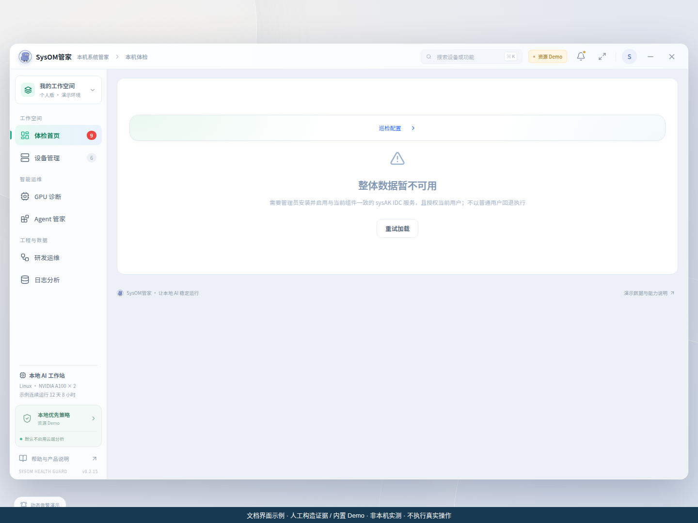

**图 2：当前界面的缺服务状态示例。** 没有资源证据时，不应生成假的评分、进程排行或“正常”结果。

- 看到“整体数据暂不可用”，先读原因，再核对管理员安装和用户授权。
- 处理服务问题后使用“重试加载”。不要把不可用理解为 CPU、内存或 GPU 为 0。
- 资源服务与 AgentSight 是独立链路：系统资源不可用时，Agent 报告仍可能可用，反之亦然。
- 刷新失败而保留的旧报告，应按**旧采样时间**解读，不当作本次结果。

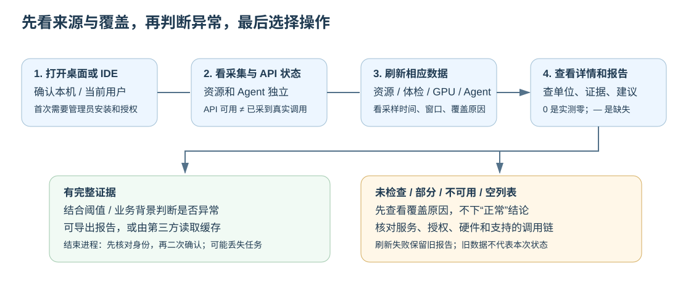

**图 3：推荐顺序。** 先判断来源与覆盖是否足够，再解释异常，最后考虑操作。

## 3. 体检首页：读懂概况、评分与巡检

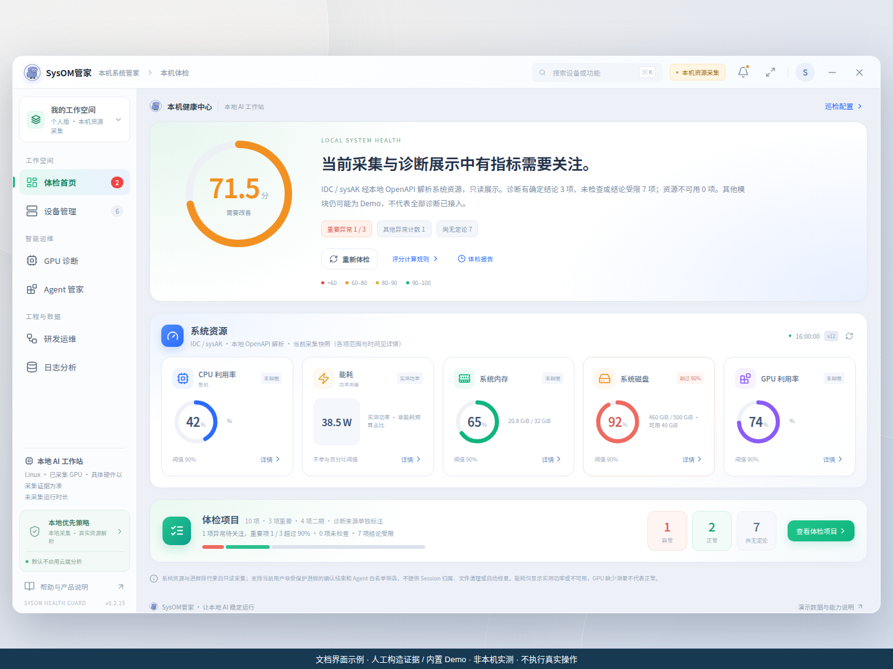

**图 4：体检首页样例。** 上部是评分与检查范围，下部是当前资源。截图中的数值是讲解样例，不是本机测量。

### 3.1 首页从上到下看什么

1. **本机健康中心：** 当前页面对象；其他设备的静态名称不要当作本机硬件事实。
2. **分数与颜色：** 表示当前可评分证据的汇总；不是全机安全认证，也不是模型能力分数。
3. **重要异常、其他异常、尚无定论：** 区分确定的异常和缺少结论的项。
4. **系统资源卡片：** 当前占用、实测量、采样时间和详情入口。
5. **体检项目：** 各项结论、受限原因和已有证据。
6. **性能监视／操作记录：** 当前快照和本实例内的操作。真实模式没有持续历史曲线或持久化报告库。

### 3.2 三个常用按钮

| 按钮 | 做什么 | 应当怎样理解输出 |
| --- | --- | --- |
| 刷新整体数据 | 更新资源快照 | 更新资源不表示所有深度诊断都已重新运行 |
| 重新体检 | 运行既有体检链路，解析结果后更新展示 | 等待完成，检查各项来源和覆盖；失败不等于正常 |
| 体检报告 | 展示并导出当前报告 | 使用当前已有快照，不是历史报告库 |

“一键优化”主要属于 Demo 分支；真实采集模式不提供一键自动修复。实际进程结束是独立、需要确认的操作，见第 4 节。

### 3.3 评分：高分不代表所有问题已排除

可点击“评分计算规则”查看计算范围。当前公式可写成：

```text
分数 = 100 - 重要异常数 × (80 / 重要检查数)
           - 其他异常数 × (20 / 其他项与已知资源总数)
最终限制在 0～100；分母为 0 时对应扣分为 0。
```

- 公式中的“重要检查数”是当前重要项总数；“其他项与已知资源总数”是其他检查总数加上已取得的资源百分比个数。检查项即使未检查仍计入对应分母，所以必须同时看覆盖提示，不能只看数字。
- “重要异常”来自已检查、使用率超过 90% 的重要项。
- “其他异常”包含其他已确认异常及超过 90% 的已知资源百分比。
- 能耗的 W 值不是百分比预算，不能当成“超过 90%”来扣分。
- 缺失百分比不参与资源阈值比较；未检查、受限和不可用项没有正常结论。
- 因此必须同时阅读“尚无定论”“资源不可用”和评分范围提示。100 分也不代表未知项已完成。
- 图例区间为 `<60`、`60–80`、`80–90`、`90–100`；颜色用于关注优先级，不替代实际证据。

### 3.4 巡检配置

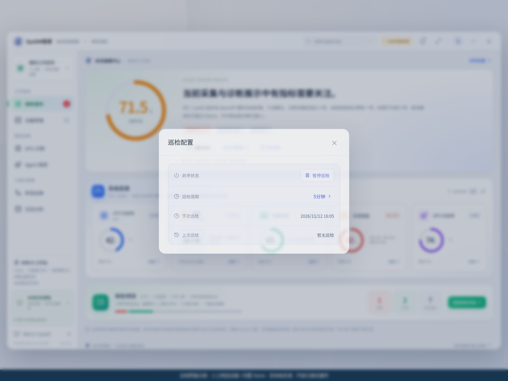

**图 5：巡检配置样例。** 这里控制本实例的系统巡检，不是开启 AgentSight 的真实调用采集。

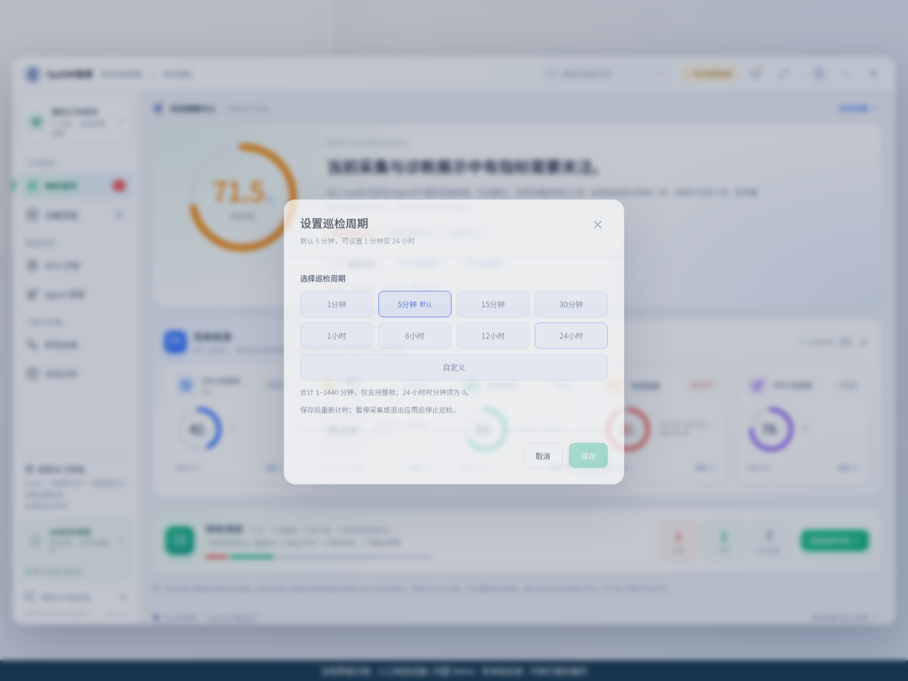

**图 5 补充：周期预设与自定义入口。**

1. 点击右上“巡检配置”。
2. 查看启停、巡检周期、上次和下次巡检。
3. 点击周期可选择 1、5、15、30、60 分钟等预设，或自定义小时和分钟。
4. 合计须为 **1–1440 分钟的整数**；24 小时时分钟必须为 0。默认 5 分钟。
5. 保存后重新计时；暂停或退出该宿主后停止此巡检。

“暂无巡检”是未记录上次巡检，不表示故障；“暂不可用”先核对安装。界面轮询缓存与真正运行巡检不是同一件事。

### 3.5 每个体检项目的结论

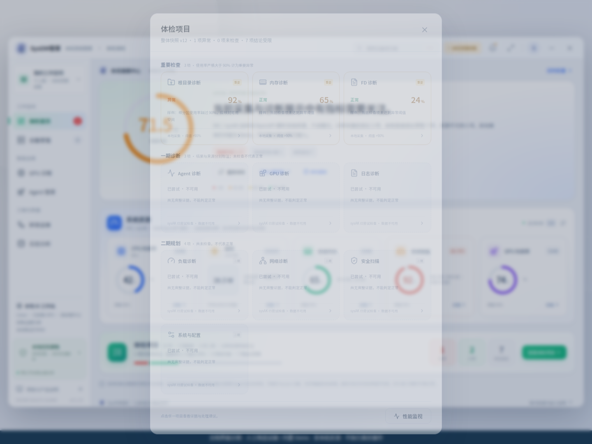

**图 6：项目列表样例。** 每项必须结合结论、执行状态和证据阅读。

| 显示内容 | 含义 | 下一步 |
| --- | --- | --- |
| 正常 | 本次已检查项在已有规则下未发现对应异常 | 仍核对采样时间和范围 |
| 异常 | 已有证据满足异常条件 | 查看证据和建议，确认业务影响 |
| 未检查 | 没有本项检查结果 | 不下正常结论 |
| 已检查 · 结论受限 | 尝试完成了一部分检查 | 阅读缺失原因，不扩大结论范围 |
| 已尝试 · 不可用 | 检查通道未取得可用数据 | 核对服务、权限、工具和硬件 |

当前根分区、FD 与内存检查已有链路，但目录扫描范围、进程数量、插件或权限可能限制覆盖。独立 Agent 管家可用，**不等于首页“Agent 状态”检查项已实现**；首页日志、网络、I/O 等项仍有待接入部分。

## 4. 资源详情：指标、排行和进程结束

### 4.1 单位不要读错

| 资源 | 首页代表什么 | 进程排行代表什么 | 不是哪种数据 |
| --- | --- | --- | --- |
| CPU | 本机 CPU 使用率 | 进程 CPU 占整机的份额 | 不一定等于单核口径的系统工具数值 |
| 内存 | 实测内存使用／总量及比例 | RSS 常驻内存，按 B／MiB／GiB 显示 | 不是进程全部虚拟地址空间 |
| 磁盘 | 已采集文件系统的空间使用与可用量 | **进程读写 I/O 速率，单位 B/s** | 不是目录大小，不是进程占据了多少磁盘空间 |
| 能耗 | 已取得的 package 功率 W，缺测则不可用 | 仅展示已有测量；可能没有进程列表 | 不是累计电量 kWh，不是估算预算百分比 |
| GPU | 已有 GPU 利用率及逐卡指标 | 以实际采集字段和范围为准 | 不能把卡级利用率分摊为每个进程利用率 |

`1 GiB = 1024³ B`，`1 MiB = 1024² B`。`B/s` 是每秒字节数；`W` 是即时功率。0 是实际观测零值；`—`、`N/A · 不可用`、`null` 是没有可靠数值。

### 4.2 查谁占用资源

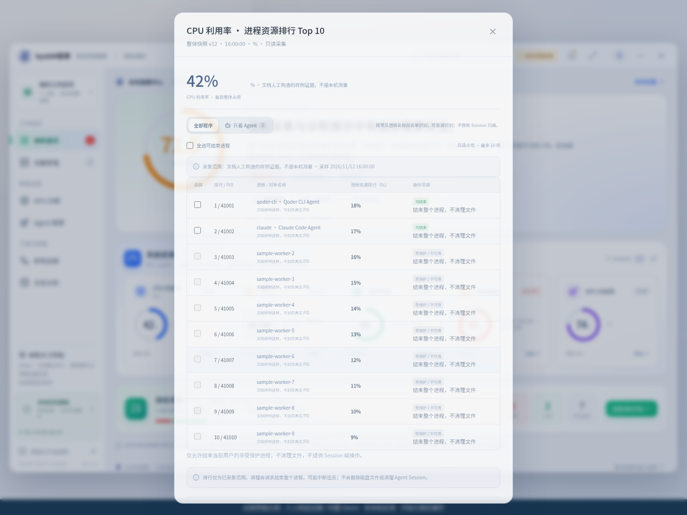

**图 7：资源详情样例。** PID、starttime 和名字全部是人为样例，不对应当前机器进程。

1. 在某资源卡片点击“详情”。
2. 看表格中的名称、PID、数值、单位和资格提示。
3. 切换“全部程序／只看 Agent”；Agent 筛选依据已识别的进程名称白名单，不是所有 AI 软件的完整发现。
4. UI 排名显示 Top10；采集通常保留整体 Top20 与 Agent Top20 的去重并集，单资源最多约 40 行。
5. 查不到某进程并不能证明它不存在或没有开销。第三方 HTTP 可以读完整**已缓存**排行，但不会扩大上游采集范围。

真实资源详情不提供 Session 资源树或按 Session 释放 CPU/GPU 的能力；离线 Demo 的 Session 演示不能用于真实任务。

### 4.3 结束进程：危险操作，和查询完全分开

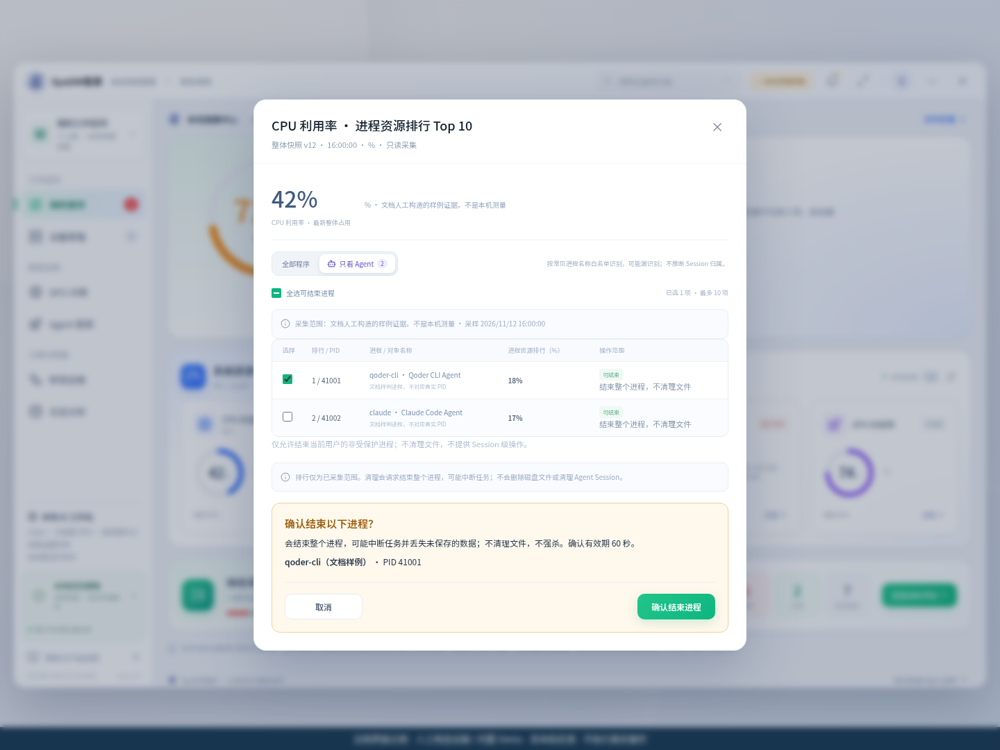

**图 8：二次确认样例。** 截图只展示确认界面，执行接口被禁止，没有发送信号。

仅对界面允许选择、且服务端校验通过的非受保护进程使用：

1. 确认不是必须保留的系统／业务进程，先保存工作。
2. 勾选目标，点击“清理所选进程”。
3. 在二次确认中再次核对 PID、身份和进程名称；确认有效期 60 秒。
4. 确认后由受控链路复核权限、快照与进程身份，再发送 **SIGTERM**。
5. 逐项读执行结果，再看刷新后的资源；发送成功不保证进程已经退出。

该操作结束**整个进程**，可能中断任务或丢失未保存数据；不删除日志、缓存或目录，不自动强杀，不自动提高跨用户权限。能否操作其他用户的进程，取决于当前受控服务授权与保护策略，不能仅凭“可清理”标记绕过复核。公共查询 API 不提供它。

## 5. GPU 诊断：把资源、执行状态和结论分开

GPU 页面有四类视图：GPU 概览、GPU 诊断、异常事件分析、作业级深度剖析。部分版本页签简称为“作业 Profiling”，以实际页面为准。

### 5.1 GPU 概览

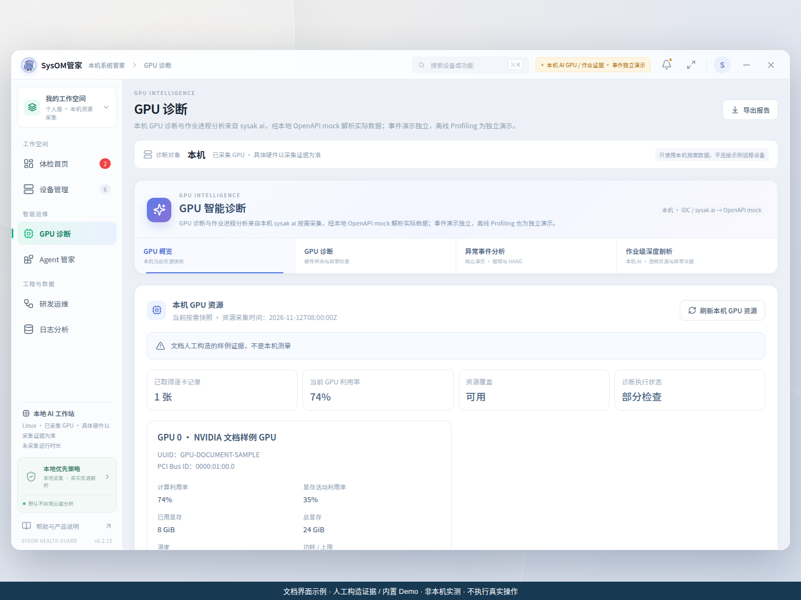

**图 9：逐卡资源样例。** “NVIDIA 文档样例 GPU”不是当前硬件型号。

- 查看索引、名称、UUID、PCI 总线，以及利用率、显存、温度、功率、ECC、PCIe 等实际已采集字段。
- 点击“刷新本机 GPU 资源”更新资源；**资源刷新不等于运行原生 AI 诊断**。
- 每个字段可能独立缺失：例如 ECC 未取到，应显示不可用，而不是 0。
- 无 GPU、驱动／权限受限、尚未采集是不同状态。真实采集模式可保留 GPU 页面解释原因；离线无卡 Demo 可能隐藏入口，不以入口是否存在判定硬件。
- 虚拟显示适配器不等于真实计算 GPU。不要把 GPU 资源可用理解为 GX 分析可用。

### 5.2 GPU 诊断

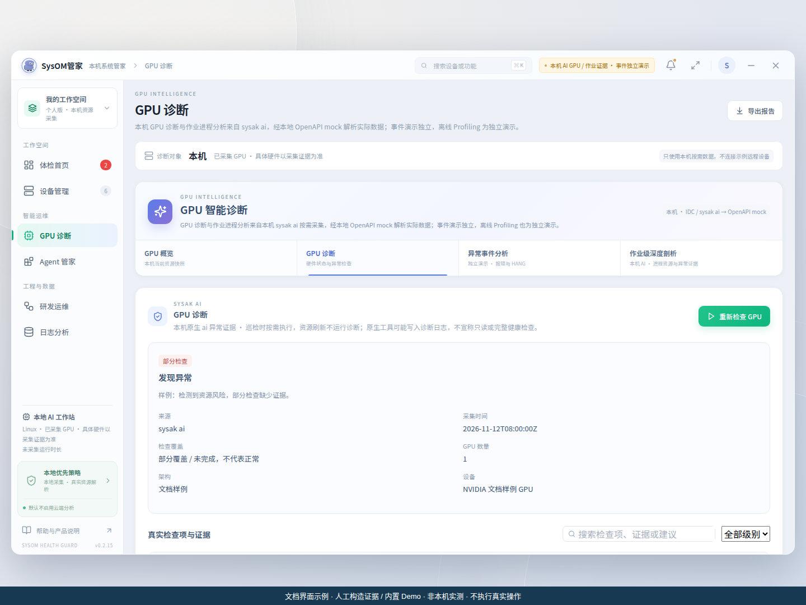

**图 10：原生 AI 检查结果的样例展示。** 样例为部分覆盖并有风险，不是完整健康结论。

1. 切换“GPU 诊断”。
2. 点击“运行 GPU 检查／重新检查 GPU”，等待 sysAK 原生 `ai` 和本地分析返回。
3. 先看执行状态：未运行、完成、部分、超时、截断、权限受限或错误。
4. 再看结果：正常／异常／未知／无 GPU，并核对本次工具检查范围。
5. 用搜索和 OK／WARN／ERROR 筛选检查项；打开或导出结果时仍保留完整已有证据。

OK 是某条检查的级别，不表示所有检查完成；WARN 是风险／警告；ERROR 是已返回异常证据。建议不是已经执行的修复。原生 AI 可能写诊断日志，不把实际执行称为严格无副作用读取；**HTTP 查询缓存**才不触发这些执行。

### 5.3 作业级深度剖析

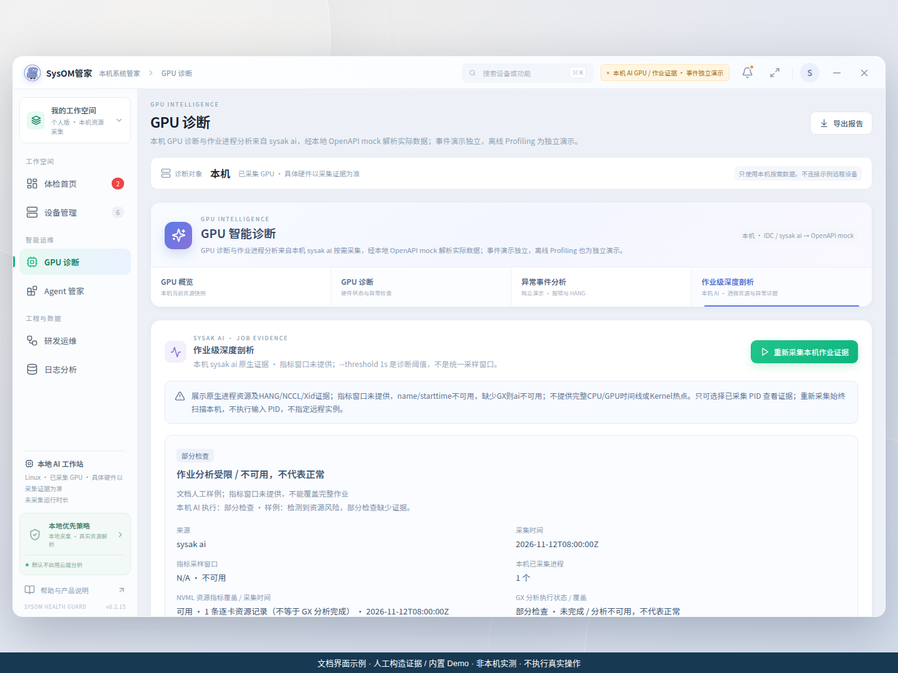

**图 11：本机作业证据样例。** 实际原生字段可能缺少名字、starttime 或利用率，必须保留不可用标记。

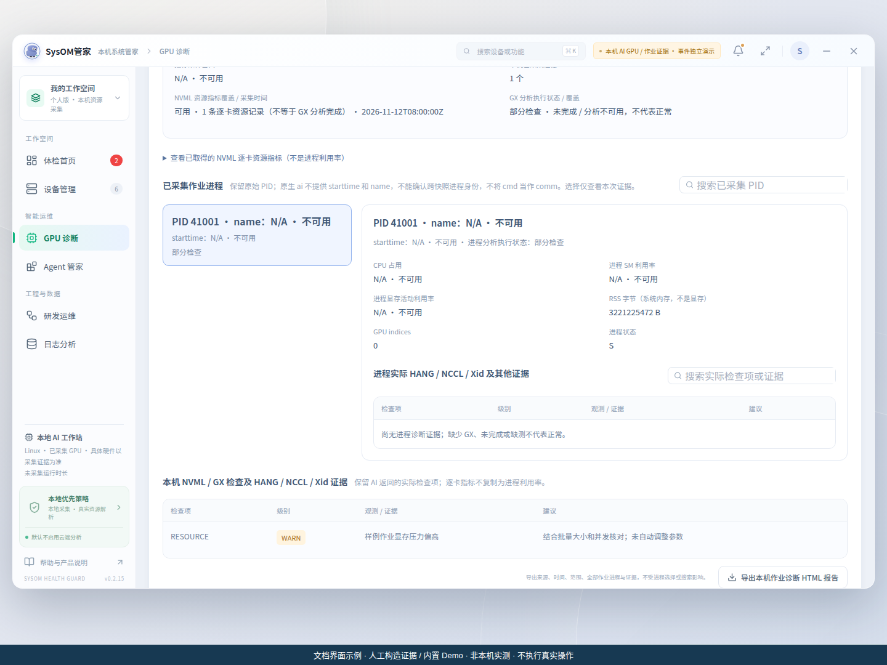

**图 11 补充：下滚后的进程选择与指标。** 样例特意保留缺失字段，卡级指标不代替进程利用率。

- 点击“采集本机作业证据／重新采集本机作业证据”按需运行本机 AI。
- 搜索和选择**已经返回的 PID**，查看已有 CPU、RSS、GPU 关联、HANG／NCCL／Xid 等证据。
- 选择 PID 只是查看已有结果，不执行输入 PID，也不选择远程实例。
- 原生 AI 强依赖 GX；缺少 GX 时分析可能不可用，独立 NVML 资源仍可能取得。
- 原生工具当前可能不提供 name 和 starttime：不要将命令行当作进程名，也不能据 PID 确定跨快照身份。
- `--threshold 1s` 是诊断阈值，**不是统一的 1 秒指标采样窗口**；窗口未提供则显示不可用。
- 卡级 NVML 利用率不能冒充进程级 SM 利用率。
- 尚未实现连续作业 Profiling、完整 CPU/GPU Timeline、Kernel 热点追踪及全作业生命周期分析。

### 5.4 异常事件与离线 Profiling 演示

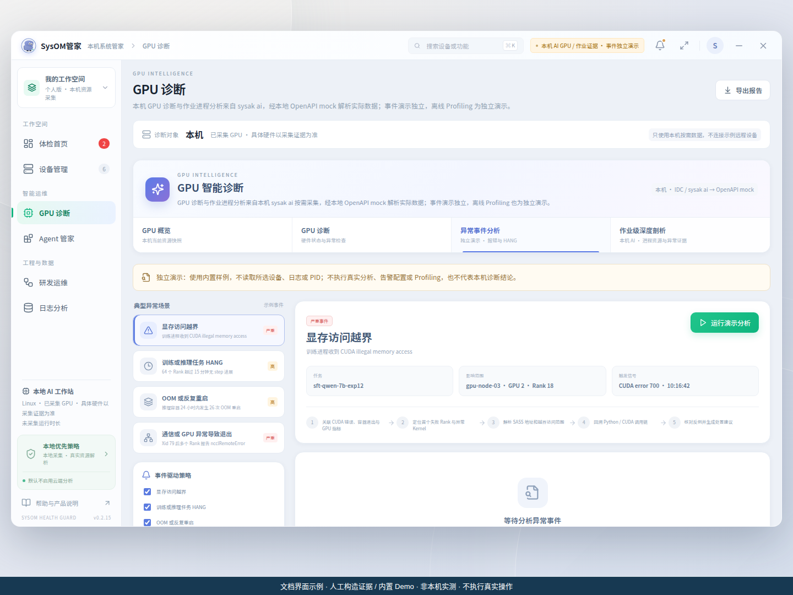

**图 12：内置 GPU 异常案例页面，属于 Demo。**

- 内置越界、HANG、OOM、通信等案例，用于说明如何组织证据与建议。
- 自主分析／报告使用内置案例，不实际调用真实分析或证明当前 GPU 故障。
- 离线 Profiling 的实例、区域、正整数 PID、采集范围是演示表单；不会采集输入实例或 PID。
- 性能时间线、吞吐／扩展／延迟／显存案例、告警渠道、模拟日报等不要当成真实集群监测或已经接入通知。

## 6. Agent 管家：看元数据，不代替业务诊断

### 6.1 先区分 API 与真实调用采集

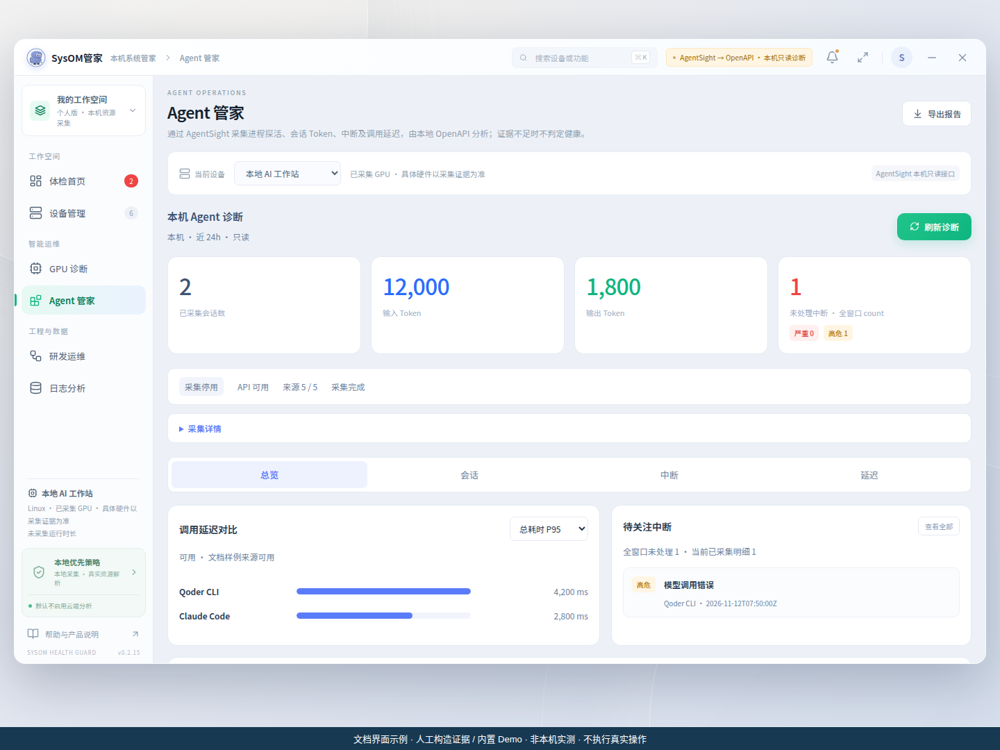

**图 13：紧凑 Agent 页面样例。** 上方统计是报告窗口汇总，中间显示 API 与真实采集状态，下方切换总览／会话／中断／延迟。

| 状态 | 说明 |
| --- | --- |
| API 可用 | 可以向 AgentSight 查询，但可能没有任何调用历史 |
| 采集停用 | 未授权／停用了真实采集；历史数据仍可能存在 |
| 采集中 | 对应 trace 服务状态正常，不保证所有客户端／TLS／协议都能捕获 |
| 采集失败 | 已启用但服务异常，不能把空记录当成健康 |
| 采集不可用／状态未知 | 未取得可靠服务状态，应查原因 |

首次准备可能要几秒。点击“刷新诊断”会通过独立 AgentSight 获取证据，再由本地 OpenAPI 分析；界面自身没有付费模型调用或自动修复。首次读取没有缓存时可能采集，与公共 HTTP 的 cache-only GET 不同。

0.2.17 的“数据范围”仅保留统计时间、更新时间和覆盖状态；来源部署与授权说明见 README。下图保留 0.2.15 的“采集详情”旧界面，不作为当前操作入口。报告主要消费五类：进程探活、会话与 Token、中断明细、未处理中断汇总、调用延迟。

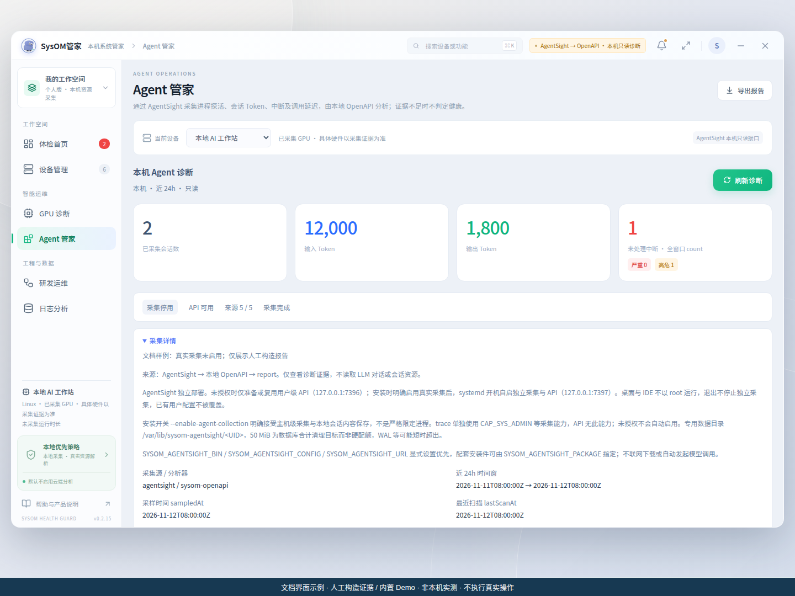

**图 13 补充：展开后的来源、覆盖、建议与采集说明。**

### 6.2 真实采集授权与隐私

**新安装入口默认只安装，不开启真实调用采集。** README 中的 `--enable-agent-collection` 是另行明确接受主机级采集的选项，不是巡检周期按钮。

- eBPF 可能捕获主机进程的明文、参数和会话内容并保存到本地；不是严格的进程隔离。
- 当前托管 trace 与 API 是独立服务，仅 trace 使用所需采集 capabilities，包括权限较大的 CAP_SYS_ADMIN；GUI／IDE 不以 root 运行。
- 专用 API 使用 7397，原有用户 API 常见为 7396；显式自定义部署优先，不覆盖用户既有配置。
- 页面和管家查询接口只暴露已经选择的诊断元数据，**但这不意味着 AgentSight 本地数据库没有原始内容**。
- 多用户、敏感或合规受限机器，应在评估采集范围后决定是否授权。不要因“本机”就认定没有隐私风险。
- 托管数据库 50 MiB 是周期性清理目标，不是硬配额；WAL、忙锁、空页等可使实际占用超出。默认保留 30 天；管家的任务缓存不是这个数据库。

具体安装、启停和状态检查按 README 操作；本文不执行授权，不读取用户数据库或配置。

### 6.3 总览：进程和证据覆盖

0.2.17 总览前置诊断结论与按类型归组的问题，可跳转只读证据，并提供实测延迟与进程探活。进程支持名称/PID 搜索、角色与状态组合筛选及每页 20 条分页，筛选回第一页；本地交互不追加采集或改变顶部统计。下图保留 0.2.15 的列表样例。

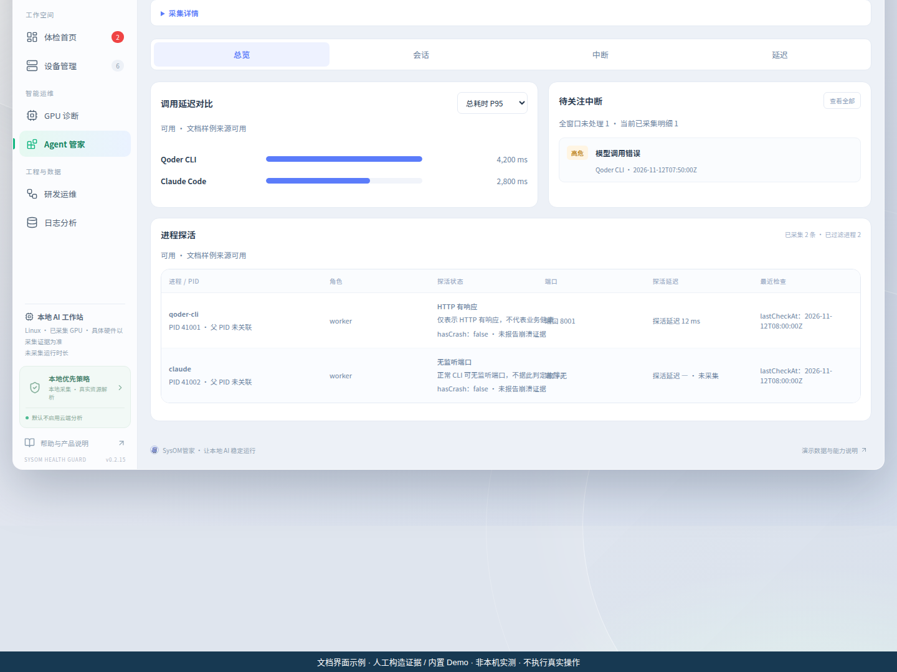

**图 13 补充：下滚后的进程列表。** 示例 CLI 没有监听端口，不直接等同异常。

- HTTP 有响应：探测到 HTTP 响应，不保证业务功能完整。
- 无监听端口：CLI 可能本来就不提供端口，不能直接判故障。
- 响应超时、端口不可达、进程已退出：结合最近检查时间和业务判断。
- 可用／不可用／无效／截断是来源状态；截断代表列表未完整返回。
- 没有发现项，不等于业务正常。建议只供核查，不会自动重启 Agent 或修复服务。

### 6.4 会话与 Token

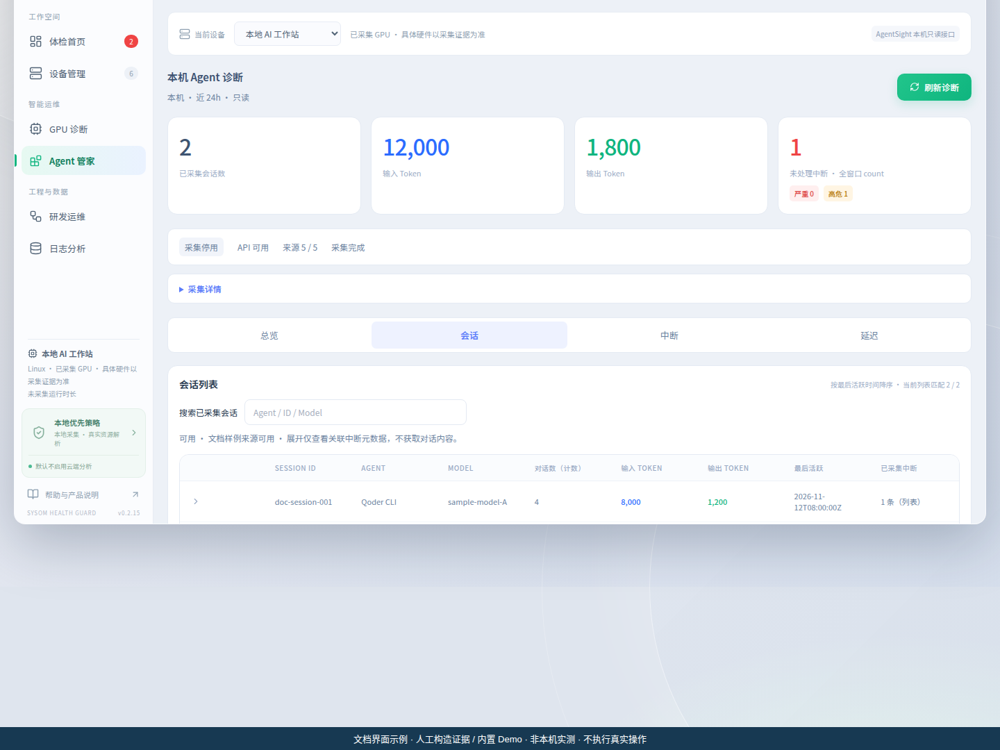

**图 14：两条人工样例会话。** 只有 ID、模型、计数和时间，没有真实对话正文。

1. 切换“会话”。
2. 输入 Agent、Session ID 或 Model 搜索当前已采集列表。
3. 看模型、对话计数、输入／输出 Token、最后活跃时间和关联中断。
4. 展开行仅看报告已有的关联中断元数据，不读取会话正文。
5. 需要进一步处理时记录 ID、时间和来源；不要向外部服务上传真实报告。

顶部 Token／会话统计不随搜索改变；它们以近 24 小时窗口内已有完整来源为准，来源不完整时可能为 `—`。0.2.17 显式包含辅助调用，输入已含缓存用量，不是会话终身累计；上游未报告 usage 的调用可能未计入，`0` 仅表示来源记录为零，不能宣称完整消耗。Token 是计数，**不是已经计算出的费用**。目前没有按 Session 准确归属 CPU、GPU、内存，也没有真实 Session 清理。

### 6.5 中断证据

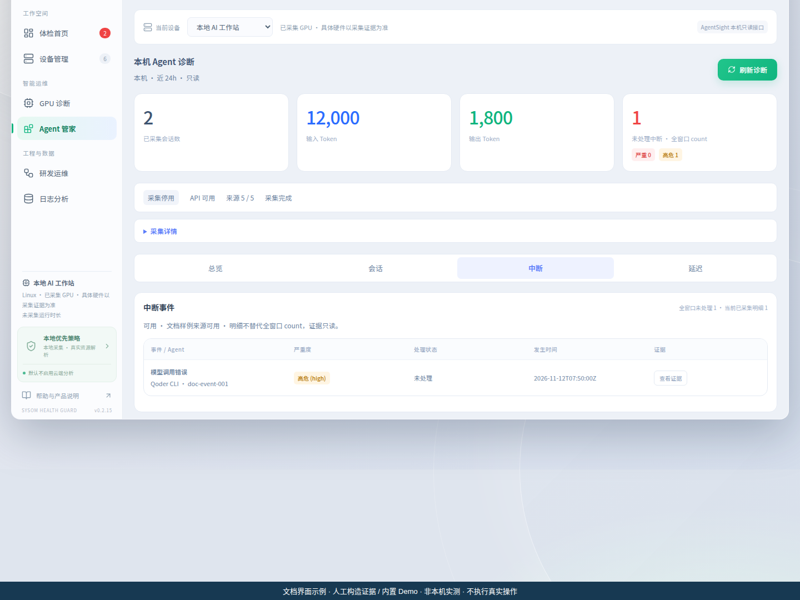

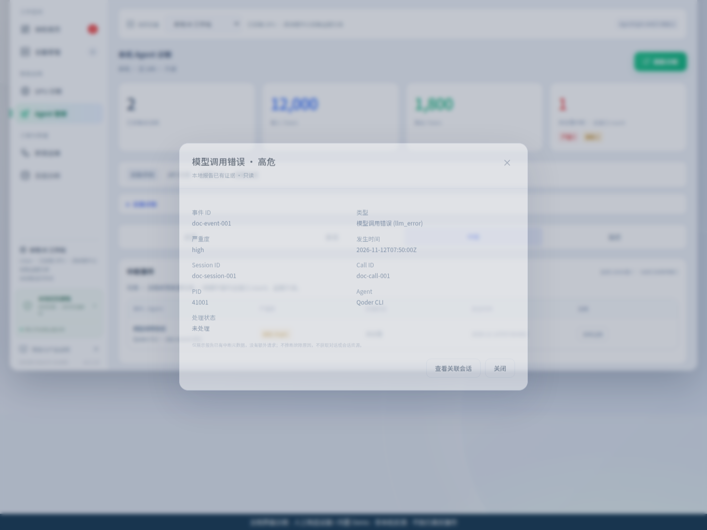

**图 15–16：样例中断和只读证据弹窗。**

- 在“中断”查看类型、严重度、发生时间、解决标记和关联 Session／Call／PID。
- “查看证据”显示当前报告已有元数据；“查看关联会话”帮助定位，不拉取对话正文。
- 类型可包含 Agent 异常退出、模型错误、工具循环风险、SSE 截断、上下文超限、Token 上限、工具错误、用户取消等，只有上游真实返回的类型才有事实含义。
- critical／high／medium／low 是严重度，不是自动修复优先级承诺。
- 中断明细最多 200 条未解决记录；总数来自汇总接口，可能比显示条数多。
- 当前只读页面不提供真实“标记解决”、重启或修复；示例设备上的恢复按钮属于 Demo。

### 6.6 延迟：等待多久，生成多快

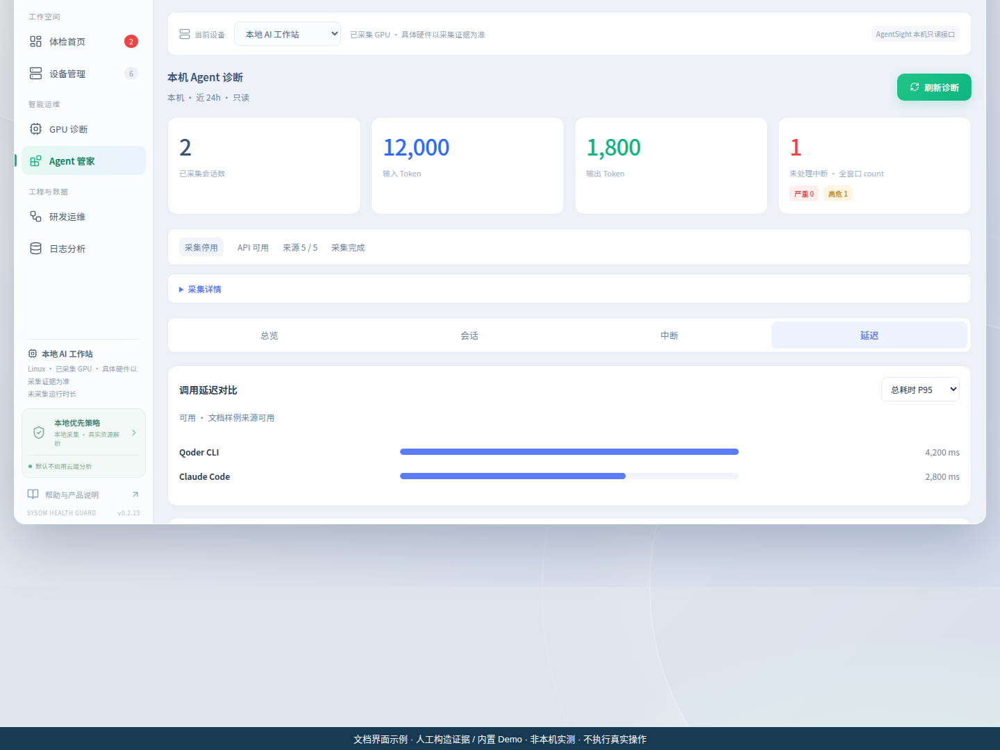

**图 17：延迟比较样例。** 某字段 `—` 表示没有该指标，不画成性能为 0。

| 指标 | 通俗解释 | 方向 |
| --- | --- | --- |
| TTFT P95（ms） | 首个 Token 出现前的等待时间的第 95 百分位 | 通常越低越好 |
| E2E P95（ms） | 一次调用总耗时的第 95 百分位 | 通常越低越好，但受输出长度影响 |
| TPS P50（Token/s） | 每秒生成 Token 数的中位数 | 通常越高越快 |
| TPOT P95（ms） | 每个输出 Token 耗时的第 95 百分位 | 通常越低越好 |
| calls／streamingCalls | 已统计调用数／流式调用数 | 用于判断样本量，不是质量分数 |

P95 不是平均值；P50 是中位数。不同模型、请求长度、样本量及窗口不能直接做公平排名。切换“对比指标”只改变当前图表，不重新采集、不改变窗口。

### 6.7 当前数据范围

报告固定使用最近 24 小时的请求窗口，进程最多 256、会话最多 500、未解决中断明细最多 200；延迟列表同样有客户端上限。具体截断、无效及不可用原因以每类 coverage 为准。窗口、时间戳和缓存是不同概念，别把一次结果当成实时全量历史库。

## 7. 设备、部署、日志与公共操作：演示能力说明

### 7.1 设备管理

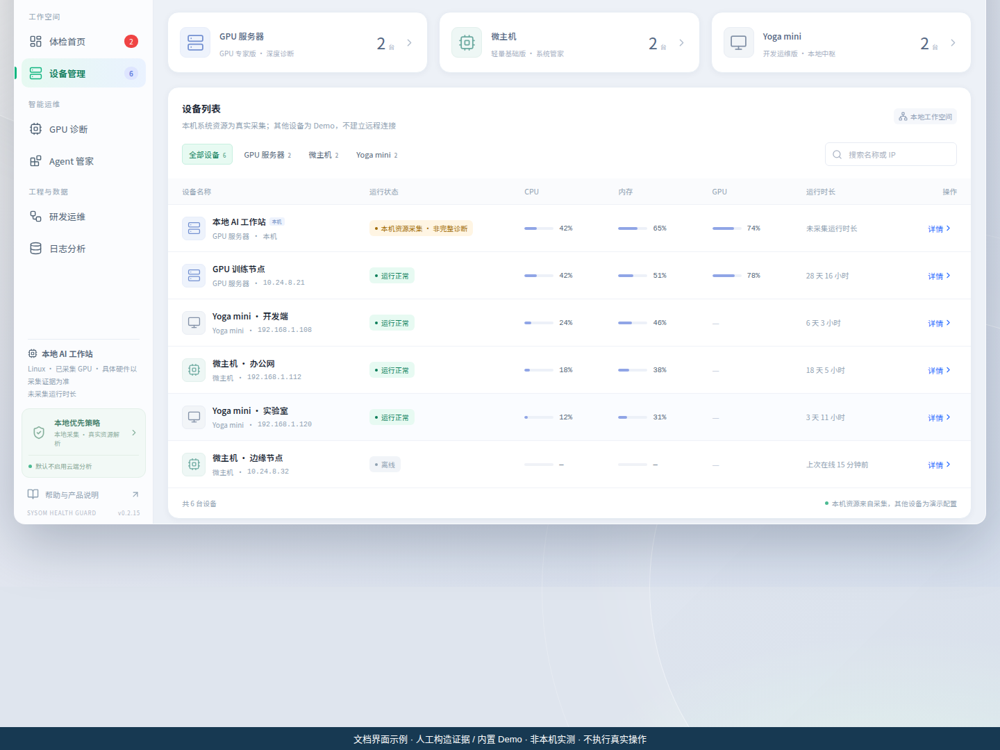

**图 18：设备管理页面。** 本机资源卡片的一部分指标来自当前快照；其他设备、IP、静态硬件和远程状态主要是内置 Demo。

- 按“全部设备／GPU 服务器／微主机／Yoga mini”等类型过滤，或用名称／地址搜索。
- “详情／设为当前设备”切换页面展示，不建立远程诊断通道。
- “接入设备”填写名称、类型、地址后“保存演示配置”：保存在当前 React 状态，不连接 SSH、不安装远端 Agent、不形成设备资产库，刷新后可能重置。
- 全局搜索支持功能与设备，Ctrl／⌘ K 打开；Esc 关闭弹窗或搜索。
- 设置、通知、分析路由、云端摘要许可等界面操作，不等于已接入外部通知、模型或配置平台。配置扫描不在当前集成范围。

### 7.2 研发运维

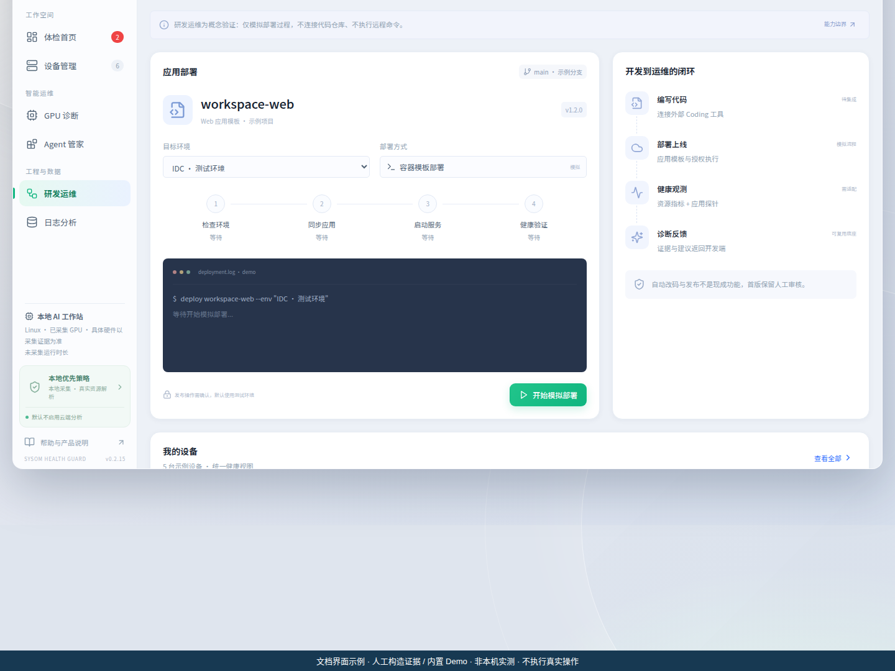

**图 19：研发运维示例界面。**

1. 选择 IDC／ECS／本地等演示环境。
2. 点击“开始模拟部署”，核对确认弹窗，再选择“确认模拟部署”。
3. 查看检查环境、同步应用、启动服务、完成检查等模拟阶段和进度。

“示例流程完成”只表示演示结束。没有部署真实应用、远程执行、CI/CD 接入、自动改代码、持久检查点或大规模任务调度。

### 7.3 日志分析

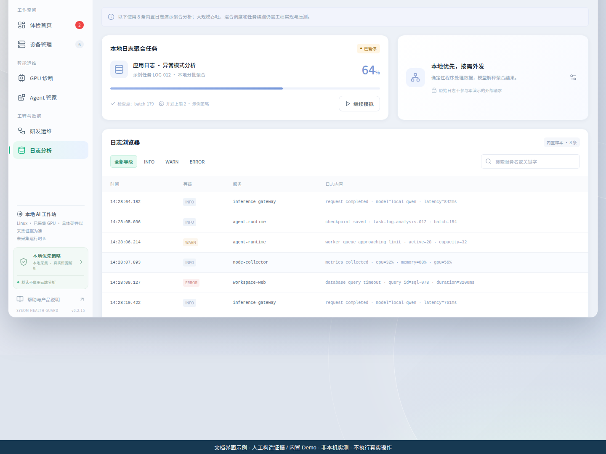

**图 20：内置日志与模拟任务。** 不读取本机真实日志文件。

- 按 ALL／INFO／WARN／ERROR 和关键词过滤当前内置日志。
- 无匹配时显示“没有匹配日志”；清空搜索恢复样例。
- “暂停／继续模拟／重新模拟”控制模拟进度，不控制真实日志采集。
- “查看优化建议”展示页面已有建议，不自动修改业务。
- 没有真实日志检索后台、日志导入流水线、索引、告警或历史报告库。公共 HTTP 不把这些 Demo 作为本机真实数据返回。

## 8. 报告与输出：导出的是什么

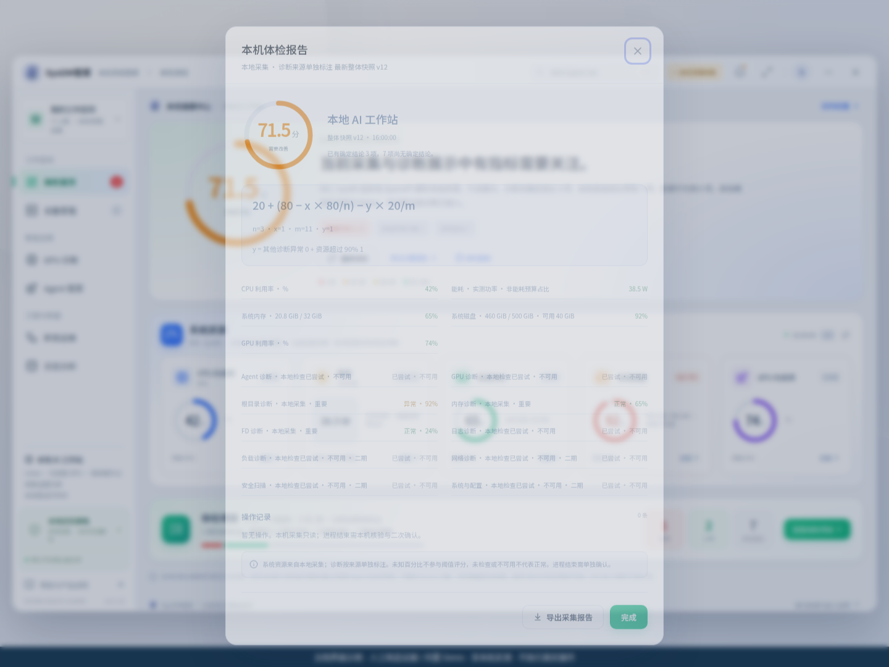

**图 21：当前体检报告弹窗样例。**

| 输出 | 内容 | 注意事项 |
| --- | --- | --- |
| 体检 TXT | 评分范围、资源、项目、证据、建议与采样时间 | 进程排行沿用 Top10；缺测保留原因 |
| GPU HTML | 执行状态、来源、检查覆盖、全部已有检查项；作业报告含已有进程 | 不受页面搜索／选择过滤；不是完整 Timeline |
| Agent JSON | 已有诊断报告、窗口、覆盖、进程／会话／中断／延迟元数据 | 没有对话正文；仍可能含敏感业务标识 |
| GPU Demo HTML | 内置事件／离线 Profiling 案例与参数 | 只能作为示例，不是实测证明 |
| HTTP report JSON | Health、摘要、健康文本、Agent 与 GPU 已缓存结果 | JSON 保留完整缓存；无缓存返回明确错误 |

桌面使用已有报告保存流程；IDE 弹出保存对话框。导出操作不创建永久报告库；需要历史留存时由使用者保存并管理。分享前检查 PID、模型名、Session ID、时间和其他业务标识，不要附带发现凭据文件。

## 9. 已完成、部分完成、演示与待完成

“已完成”指当前实现存在，**不表示所有发行版、硬件、权限和第三方客户端都已验证**。待完成项是当前缺口，不是排期或交付承诺。

| 能力 | 状态 | 当前可用范围／缺口 |
| --- | --- | --- |
| 桌面窗口、小管家与 IDE 面板／状态栏 | 已完成 | 两种宿主；本批次隔离原生验收不等于系统安装或全硬件认证 |
| 本机资源、单位、采样时间、Top10 | 已完成，采集有界 | 不是全进程／全历史数据库；部分字段可缺测 |
| 巡检启停、1–1440 分钟周期 | 已完成 | 每宿主独立；退出停止本实例巡检 |
| 分数、覆盖提示、TXT 报告 | 已完成 | 只说明当前证据；不是完整健康认证 |
| 根分区／目录、FD、内存体检 | 部分完成／覆盖受限 | 有真实链路，扫描和插件不能保证完整覆盖 |
| 首页 Agent、日志、网络、I/O 诊断 | 尚有待完成部分 | 不用独立 Agent 页结果假装首页全接入 |
| GPU 逐卡资源 | 已完成，硬件相关 | 依赖实际支持的硬件、驱动和采集字段 |
| sysAK 原生 AI GPU 检查 | 已接入，证据受限 | 按需执行；GX 等缺失、超时和日志写入需如实说明 |
| 作业 PID 与原生异常证据 | 部分完成 | 缺 name／starttime／采样窗口时不补造 |
| 连续 Profiling、Timeline、Kernel 热点 | 待完成 | 当前真实页仅已有原生证据；离线案例不算实现 |
| GPU 事件案例／离线 Profiling／告警渠道 | Demo | 不实际采集远程实例或接入通知 |
| AgentSight 独立部署／五类元数据诊断 | 已完成链路，来源有界 | API 和 trace 独立；并非所有调用都支持 |
| 真实调用 trace/API 受控服务 | 已实现，可选授权 | 主机级隐私风险；清理目标非硬磁盘配额 |
| Agent 自动修复、真实重启／标记解决 | 待完成 | 建议只读；示例恢复流程为 Demo |
| Session 真实资源归属与清理 | 待完成 | 不按 Session 拆 CPU/GPU，也不清真实会话 |
| 受控进程结束 | 已完成受控流程 | 身份权限复核、二次确认、SIGTERM；不保证退出、不删文件 |
| 远程设备接入／资产库 | Demo／待真实接入 | 当前设备添加仅本地界面状态 |
| 真实部署／日志平台／配置扫描 | 未实现或不在当前范围 | 部署、日志界面为 Demo；不恢复 confscan 集成 |
| 本机只读 HTTP 与 15 数据集 | 源码已完成 | 安装件需实查发现文件和能力；旧包不会自动更新 |
| 持久化资源历史／任务库／报告库 | 待完成 | 管家缓存跟随宿主；不与 AgentSight 本地数据库混淆 |

### 验证范围说明

- 本文名称、版本和操作说明对应 SysAgent 0.2.17；双端构建成功，隔离 AppImage 原生验收 30/30、IDE 原生验收 24/24 通过，涵盖本地时间显示、刷新失败保留旧结果、分页与窄屏；全量回归及最终发布包校验结果见根 README，旧版本数量和哈希不是 0.2.17 结果。
- 配图保留改名前 0.2.15 共享 React 页面和人工夹具的展示／导航，包括只读确认样例；该次截图没有 root 执行、真实 GPU 检查、用户会话读取、信号或外部请求，旧品牌与时间格式不代表当前显示。
- 文档阅读版重新生成并检查 26 张图片、链接与桌面／手机布局；本批次同时重新打包并隔离验收原生 Electron／IDE 外壳，不安装／升级系统服务，不改变采集授权，不发起模型调用；未认证全部真实正向硬件链路。
- 查询 API 的实现与测试记录见专项文档；检查正在使用的实例是否真正开放接口，再决定对接，不能单看版本号。

## 10. 第三方程序怎样对接

### 10.1 推荐：本机只读 HTTP，不抓网页 DOM

第三方应用应读取稳定的 JSON 数据和能力目录，不解析页面文字，也不直接使用 UI 的内部 IPC 或 root socket。HTTP／JSON 方便 Python、curl、Node、Go 等接入；特权执行仍保留 Linux socket 边界。

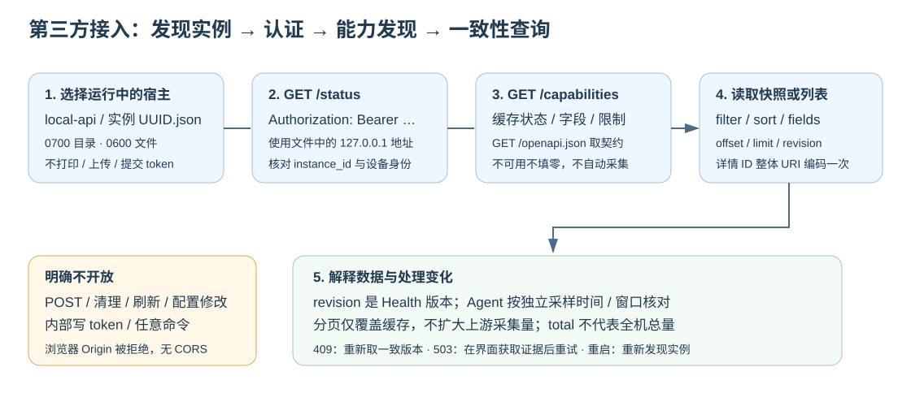

**图 22：本机接入流程。** GET 只读缓存；需要新证据应在管家相应页面运行刷新或诊断，不把轮询接口当成执行入口。

### 10.2 发现地址与认证

桌面控制器和 IDE 扩展激活时各自启动随机回环端口，并创建：

```text
宿主用户存储目录 / local-api / <instance UUID>.json
```

- 桌面根目录来自 Electron `app.getPath('userData')`。
- IDE 根目录来自 `context.globalStorageUri`，扩展 ID 为 `sysagent-local.sysagent-ide`。
- 文件包括 `base_url`、`token`、`instance_id`、`host_kind`、`device_id`、进程与启动时间；目录 0700、文件 0600。
- 以当前用户选择实际发现文件；不硬编码端口或产品配置目录，不批量扫描其他用户。
- 使用文件中的 `127.0.0.1` 地址和 `Authorization: Bearer …`；不要替换成 `localhost`、附 Origin，或开启跨域代理绕过校验。
- 不打印／提交／上传 token，不放进 URL、进程命令行或公开日志。查询 token 和内部分析 token 不同。
- 不安全目录／符号链接会导致查询启动失败，不自动修改权限。控制器的 `query_api.error` 可提供状态；原有采集不因此必然失败。
- 正常关闭删除本实例文件；崩溃可能留下旧文件。客户端必须验证连通性及 instance，重启后重新发现。

### 10.3 八类路径与 15 个数据集

所有路径只允许认证 **GET**：

| 路径 | 返回内容 |
| --- | --- |
| `/api/v1/status` | 安装、启停、阶段、周期、最近任务与错误 |
| `/api/v1/capabilities` | 数据集目录、合法字段、缓存状态、限制、未开放功能 |
| `/api/v1/snapshot` | 一次一致读取 status、Health state、Agent report、tasks |
| `/api/v1/summary` | 同 UI 的评分与未知／不可用范围 |
| `/api/v1/report` | Health、摘要、文本、Agent 和 GPU 结构化报告 |
| `/api/v1/datasets/{name}` | 列表筛选、排序、字段投影和分页 |
| `/api/v1/datasets/{name}/{id}` | 缓存对象详情，ID 整体编码一次 |
| `/api/v1/openapi.json` | OpenAPI 3.1 契约，不是内部写契约 |

| 数据集 | 包含什么 |
| --- | --- |
| `resources` | 各资源完整已有快照与逐资源状态 |
| `resource-rows` | 完整已缓存进程排行、单位、身份和 Agent 识别 |
| `inspections` | 体检项目、执行范围、结论与证据 |
| `optimizations` | 当前已有建议，不表示自动修复已实现 |
| `operations` | 本实例最近操作，最多 30 条 |
| `gpu-devices` | 逐卡资源遥测 |
| `gpu-findings` | GPU 原生检查项、级别、证据与建议 |
| `gpu-jobs` | 已返回作业 PID 和原生进程证据 |
| `agent-processes` | AgentSight 进程探活；没有可靠 starttime |
| `agent-sessions` | 模型、计数、Token、首末时间，没有对话正文 |
| `agent-interruptions` | 已选择的中断元数据 |
| `agent-latency` | 调用数、TTFT、E2E、TPS、TPOT |
| `agent-findings` | 独立 Agent 发现与建议 |
| `agent-coverage` | 五类来源状态与受限原因 |
| `tasks` | 本进程最多 100 条成功采集／诊断任务元数据 |

公共接口没有 `/api/v1/resources` 快捷路由，没有 POST 刷新、结束进程、修复、配置修改、任意文件读取或任意 AgentSight 路径代理。

### 10.4 返回结构与关键字段

非数据集接口通常返回：

```json
{
  "schema_version": "1.0",
  "meta": {
    "instance_id": "说明性实例标识",
    "host_kind": "electron",
    "device_id": "说明性设备标识",
    "revision": 12,
    "sampled_at": "2026-11-12T08:00:00Z",
    "agent_sampled_at": null,
    "cache_only": true
  },
  "data": {}
}
```

这是结构示意，不是一次实测响应；`data` 按路径不同。snapshot 的 `data` 为 `{status, state, agent, tasks}`；state／agent 可以为 `null`。OpenAPI 路径直接返回契约。

数据集列表直接返回 `{schema_version, dataset, meta, total, offset, limit, items, next_offset}`，**不再套一层 `data`**；详情直接返回 `item` 与元信息。准确 Schema 以服务的 OpenAPI 为准。

- `revision` 只标记 Health 快照；Agent 有独立时间和请求窗口。
- `total` 是筛选后**缓存**条数，不是全机／上游总量。
- `next_offset` 为下一页位置或 null。
- `status`、coverage 和 reason 必须保留，不能把空值转换为正常或 0。
- 外层 `mode: "mock"` 是既有部署标签；应同时检查 state 的 `mode: "collected"`、任务 `simulated: false`、来源、时间与覆盖。不仅凭一个词判断数据真实性。

### 10.5 查询参数

| 参数 | 例子 | 语义 |
| --- | --- | --- |
| `filter.<field>` | `filter.resource=cpu` | 精确匹配；同字段多值 OR，不同字段 AND；标量数组按包含匹配 |
| `min.<field>`／`max.<field>` | `min.usage=10` | 合法数字或 ISO 时间的含端点范围 |
| `q` | `q=qoder` | 缓存文本子串检索，不执行正则、表达式或 SQL |
| `sort` | `sort=-usage,pid` | 多字段排序，`-` 为降序，缺失值在后 |
| `fields` | `fields=queryId,name,pid,usage` | 合法字段投影，未填返回完整允许对象 |
| `offset`／`limit` | `offset=0&limit=100` | 默认 0／100；每页 1–1000 |
| `revision` | `revision=12` | Health 版本一致性条件，不匹配 409 |

合法字段先查 capabilities；未知／重复／重叠投影或非法查询拒绝。详情只支持 fields 与 revision；status、snapshot、summary、report 等不支持附带列表参数。

资源行详情优先使用 `queryId`（资源名 + 原始 ID），避免不同资源复用 ID。进程身份只有 PID 不足够，有可靠 starttime 时需联合核对；原生 GPU／Agent 来源缺 starttime 时合成 ID 只在当前快照使用。

### 10.6 Python：读 CPU 排行并查询详情

在自己的运行环境中将 `SYSOM_QUERY_DISCOVERY` 设置为选定实例的**真实发现文件绝对路径**。示例只读取该文件与查询结果，不打印凭据。

```python
import json
import os
from urllib.parse import urlencode, quote
from urllib.request import Request, urlopen

with open(os.environ['SYSOM_QUERY_DISCOVERY'], encoding='utf-8') as file:
    endpoint = json.load(file)


def get(route, params=None):
    url = endpoint['base_url'] + route
    if params:
        url += '?' + urlencode(params)
    request = Request(url, headers={
        'Authorization': 'Bearer ' + endpoint['token'],
    })
    with urlopen(request, timeout=5) as response:
        return json.load(response)


catalog = get('/api/v1/capabilities')
snapshot = get('/api/v1/snapshot')
revision = snapshot['meta']['revision']
rows = get('/api/v1/datasets/resource-rows', {
    'filter.resource': 'cpu',
    'sort': '-usage,pid',
    'fields': 'queryId,resource,name,pid,starttime,usage',
    'limit': 100,
    **({'revision': revision} if revision is not None else {}),
})
print(json.dumps(rows, ensure_ascii=False, indent=2))
if rows['items']:
    identity = quote(rows['items'][0]['queryId'], safe='')
    detail = get('/api/v1/datasets/resource-rows/' + identity,
                 {'revision': revision} if revision is not None else None)
    print(json.dumps(detail, ensure_ascii=False, indent=2))
```

无缓存或版本变化时此最小示例会抛出 HTTP 错误，不静默填假数据。正式客户端应按下面的错误码处理；列表跨页核对同一 Health revision，Agent 跨页另核对采样时间／窗口，发生变化重新查询。

### 10.7 curl：凭据不要放命令行

凭据通过 stdin 进入 curl 配置；不要加 `-v` 打印敏感请求头：

```bash
python3 - <<'PY' | curl --silent --show-error --fail --config -
import json, os
with open(os.environ['SYSOM_QUERY_DISCOVERY'], encoding='utf-8') as file:
    endpoint = json.load(file)
print('url = ' + json.dumps(endpoint['base_url'] + '/api/v1/snapshot'))
print('header = ' + json.dumps('Authorization: Bearer ' + endpoint['token']))
PY
```

### 10.8 错误怎样处理

错误形如 `{schema_version: "1.0", error: {code, message}}`。

| HTTP | 常见原因 | 客户端应做什么 |
| --- | --- | --- |
| 400 | 参数／字段／路径不合法 | 对照 capabilities 和契约修正 |
| 401 | 查询凭据缺失或错误 | 重新选择并读取自己的活跃发现文件，不打印 token |
| 403 | Host／Origin 等边界不符合 | 使用原始回环地址，别从浏览器直连或绕过限制 |
| 404 | 路由、数据集或 ID 不存在 | 查目录；ID 可能只属于旧快照 |
| 405 | 请求不是 GET | 不重试写入，改用只读接口 |
| 409 | revision 变化或详情身份歧义 | 重新取得一致快照和正确 detail ID |
| 503 | 所需缓存尚不存在／来源未就绪 | 在界面获取相应证据；查询不会替你采集 |
| 连接失败 | 宿主已退出或文件过期 | 重新发现活跃实例，不凭文件存在判断存活 |

已有“部分／不可用”的对象可能以成功响应返回，因为状态本身就是查询结果；HTTP 200 不能代替业务状态判断。

## 11. 代码结构与扩展接入

### 11.1 在哪里改什么

以下路径均以项目 `sysom_idc/` 为根，不是旧 Demo 的目录结构。

| 路径 | 职责 |
| --- | --- |
| `sysom_idc/sysagent-idc/src/App.tsx` | 导航、设备、日志、运维、公共弹窗 |
| `sysom_idc/sysagent-idc/src/DesktopDemo.tsx` | 主页、小管家、缓存轮询与告警展示；名字保留历史，不能据名字判 Demo |
| `sysom_idc/sysagent-idc/src/HealthGuardPage.tsx` | 资源、体检、报告、进程确认 |
| `sysom_idc/sysagent-idc/src/CollectionStatus.tsx` | 巡检配置与周期输入 |
| `sysom_idc/sysagent-idc/src/ResourceRankings.tsx` | 真实 Top10／Agent 筛选与独立 Demo Session 展示 |
| `sysom_idc/sysagent-idc/src/GpuDiagnostics.tsx` | GPU 概览、检查、原生作业证据、Demo 事件／Profiling |
| `sysom_idc/sysagent-idc/src/AgentDiagnostics.tsx` | 本机只读 Agent 视图与独立示例视图 |
| `sysom_idc/sysagent-idc/src/health-data.ts` | 资源／体检模型、评分与 TXT 报告 |
| `sysom_idc/sysagent-idc/src/agent-diagnostics-data.ts` | Agent 元数据类型、来源与状态标签 |
| `sysom_idc/sysagent-idc/src/idc-client.ts` | UI 到宿主 IPC／Webview 或开发 HTTP 的调用 |
| `sysom_idc/sysagent-idc/electron/main.cjs`／`preload.cjs` | 桌面窗口、生命周期、严格 IPC 桥接 |
| `sysom_idc/sysagent-ide-extension/src/extension.ts` | IDE 扩展激活、状态栏、RPC、报告保存与查询启动 |
| `sysom_idc/sysagent-idc/electron/idc-controller.cjs` | 采集调度、缓存、独立 Agent 诊断、任务与受控操作 |
| `sysom_idc/sysagent-idc/electron/local-query-api.cjs` | 公共本机只读 HTTP、认证、发现与生命周期 |
| `sysom_idc/sysagent-idc/electron/query-data.cjs` | 15 数据集、静态字段白名单、查询规则与契约 |
| `sysom_idc/sysagent-idc/openapi-service.ts`／`collected-state.ts` | 内部证据规范化、真实资源解析与报告函数导出 |
| `sysom_idc/sysagent-idc/electron/generated/openapi.cjs` | 既有构建生成的共享 CommonJS；不要手改 |
| `sysom_idc/sysagent-idc/electron/agentsight-client.cjs`／`agentsight-deployment.cjs` | 选择性元数据获取、独立配套准备、受控服务启动 |
| `sysom_idc/sysagent-idc/electron/sysak-root.cjs`／`build/sysak-root-runner.py` | 固定 root 安装验证与 socket 执行边界 |
| `sysom_idc/sysagent-idc/tests/`／`sysagent-ide-extension/test/` | 模型、解析、权限、HTTP 和宿主验收 |
| `sysom_idc/sysagent-idc/backend/` | 未接入当前前端的历史 FastAPI 骨架，不能当作真实查询入口 |

### 11.2 新增一种查询数据的正确方向

1. 先确定真实来源和保留范围：哪些是零、未知、不可用、截断；是否涉及隐私。
2. 在数据模型／解析中形成结构化结果，保留来源、时间和覆盖，不直接把任意文件或原始会话公开。
3. 在控制器保留明确缓存，通过同步 `queryView()` 读取副本；**不要在 GET 路由调用可能采集的 snapshot／agentSnapshot**。
4. 在 `query-data.cjs` 声明字段白名单、身份、过滤／排序／范围规则和 OpenAPI Schema。
5. UI 和 HTTP 复用已有业务模型；执行动作走另行评审的受控链路，不混入查询接口。
6. 增加无缓存、部分证据、身份变化、分页、非法参数、认证、安全边界和契约一致性测试。

内部 `/openapi/v1/collections` 和 `/openapi/v1/agent-diagnostics` 用于证据分析／规范化，不是第三方公开写入口；不提供其 token，也不直接代理。AgentSight 只消费明确允许的五类路径，不开放通用路径穿透。

### 11.3 开发与构建入口

已具备依赖时，在各项目目录执行：

```bash
# sysom_idc/sysagent-idc
npm run build
npm test

# sysom_idc/sysagent-ide-extension
npm run typecheck
npm run build
```

桌面 build 先生成共享 OpenAPI，再做 TypeScript 和 Vite 构建；IDE 复用模型并打包宿主／Webview。安装用户不需要开发工具，也不需要启动历史 FastAPI。开发命令可能运行真实采集服务，不能把普通 Vite 开发入口当成完全隔离的演示环境。

本文截图脚本位于 `sysom_idc/docs/scripts/capture-user-guide.cjs`：仅载入当前 React 源码，不加载采集插件，注入人工样例，阻止外部请求与真实执行。需要已存在的项目 Node 依赖、本机 Chrome 和沙箱可用；不安装额外软件，不用 `--no-sandbox`。截图来源与结果记录在[截图清单](./assets/user-guide/capture-manifest.json)。

## 12. 常见疑问速查

| 问题 | 答案 |
| --- | --- |
| 为什么有高分还有“未检查”？ | 分数只描述当前可评分证据，未知不等于正常。 |
| 为什么磁盘空间和排行看起来不对应？ | 首页是空间容量；排行是进程 B/s I/O，二者不是同一个量。 |
| 为什么 Agent API 可用但没有会话？ | API 本身不生成历史；trace 可能未启用、失败或没捕获支持的调用。 |
| 为什么停止 trace 后还能查到数据？ | 停止采集不删除已有历史；报告应按时间和窗口理解。 |
| 为什么 GPU 资源有值、AI 却不可用？ | NVML／资源来源与原生 GX 分析是不同能力。 |
| 为什么点击 PID 不能深度追踪该进程？ | 当前只选择已有证据；连续 Timeline 和指定 PID 采集未实现。 |
| 为什么 HTTP GET 后数据没变？ | 接口只读缓存，不采集；须用管家刷新／诊断或等待已有巡检。 |
| 为什么重启后 HTTP 端口变化／任务为空？ | 每实例随机端口；管家缓存不是持久化历史库。 |
| 为什么浏览器网页访问接口失败？ | 有意拒绝 Origin，不开放 CORS；用本机受信程序，不绕过边界。 |
| 为什么关闭主页应用还在？ | 收起到悬浮小管家；彻底退出使用右键“退出”。 |
| 如何确认安装件真的有新接口？ | 查该宿主实际发现文件与 capabilities；不要只凭源码或版本号。 |

### 进一步阅读

- [当前发布、安装与服务授权](../README.md)
- [本机只读 HTTP 参数、安全约束及测试记录](./LOCAL-HTTP-API.md)
- [系统采集与内部 OpenAPI 设计](./SYSAGENT-IDC-OPENAPI-DETAILED-DESIGN.md)
- [开发文档](./DEVELOPMENT.md)：包含历史 Demo 段落，请以当前源码与本文的真实／演示边界为准。
